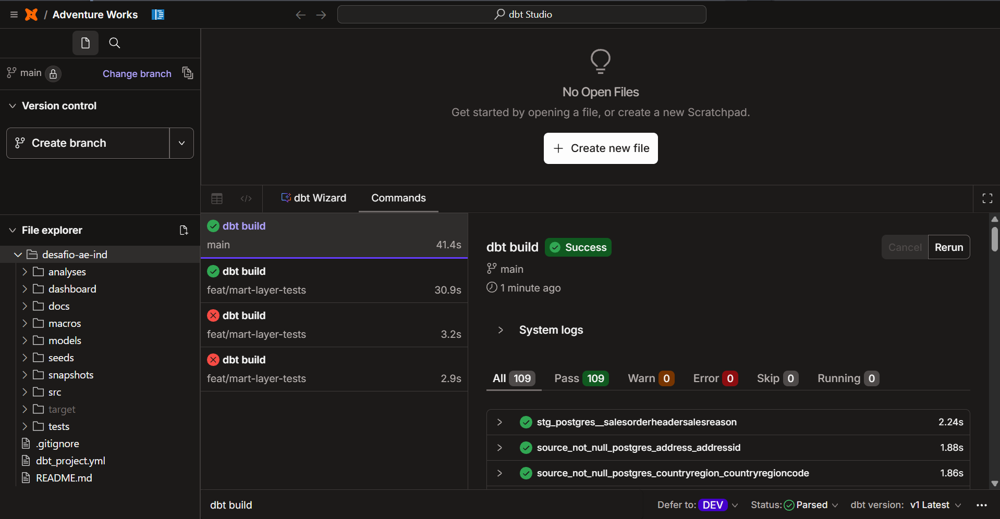
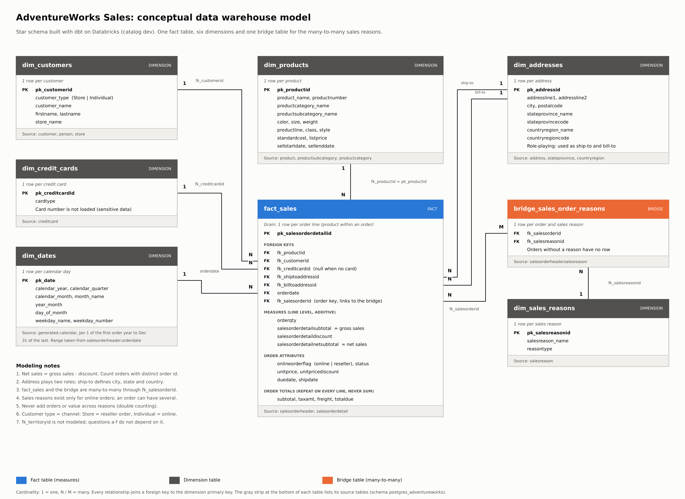
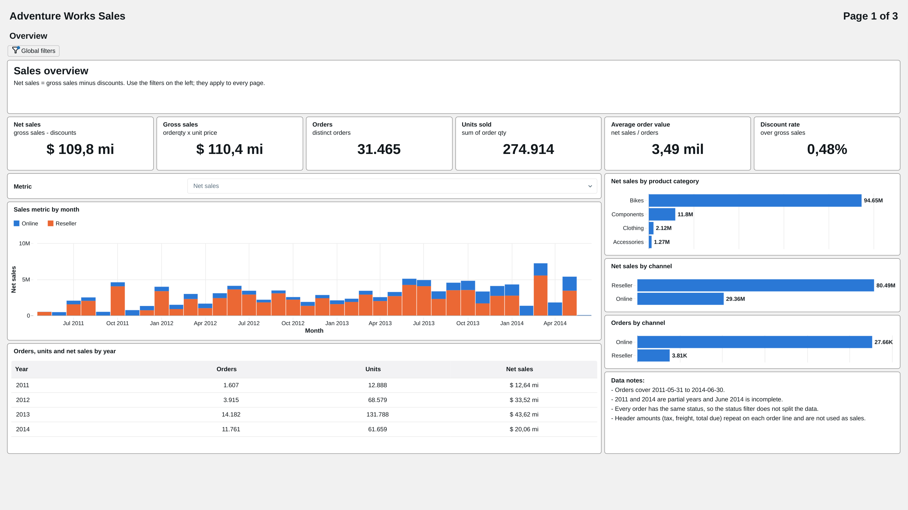
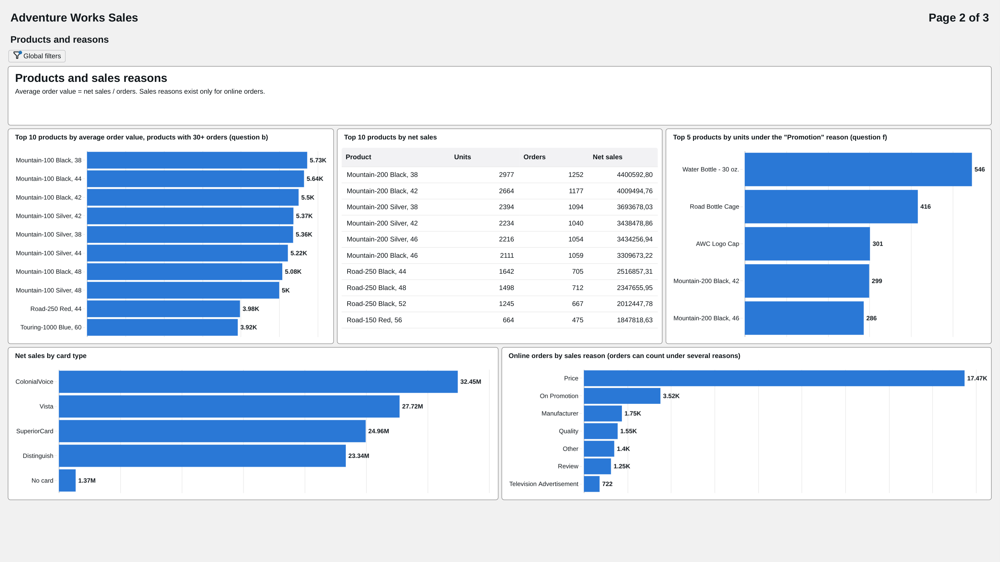
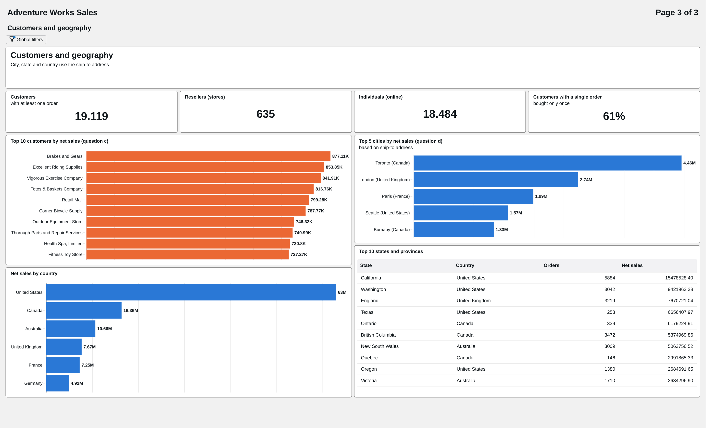
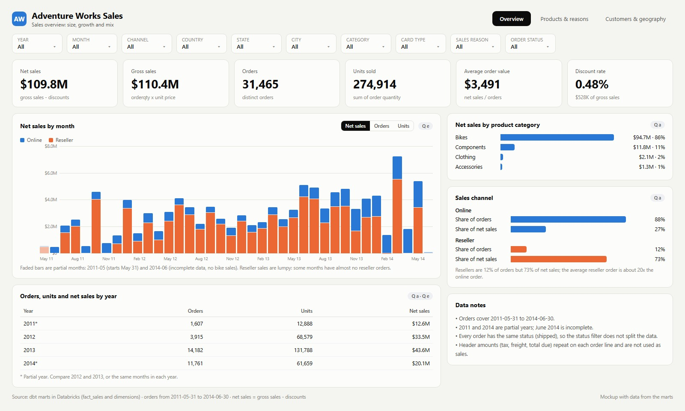

# desafio-ae-ind

Projeto do desafio de Analytics Engineering sobre o dataset AdventureWorks:
carrega os dados de vendas do Postgres para o Databricks, transforma em um modelo
dimensional (star schema) com dbt, documenta e testa o resultado e entrega um
dashboard de vendas.

O desafio pede que os números sejam confiáveis. O CEO citou um valor de
referência da auditoria, as vendas brutas de 2011 (US$ 12.646.112,16), e esse
valor é conferido por um teste automático a cada execução.

## Visão geral do processo

```
Postgres (AdventureWorks)  →  dlt  →  Databricks (raw)  →  dbt  →  marts  →  dashboard AI/BI
        origem                  EL      postgres_adventureworks    staging,    Adventure Works Sales
                                                                   intermediate,
                                                                   marts
```

| Etapa | O que acontece | Onde está |
|---|---|---|
| 1. Extração e carga (EL) | dlt copia as tabelas do Postgres para o schema `postgres_adventureworks` no Databricks | [src/Extract](src/Extract/README.md) |
| 2. Transformação | dbt limpa, junta e modela os dados em três camadas | `models/` |
| 3. Qualidade | testes nas fontes, nas chaves, nas relações e nas regras de negócio | `models/**/*.yml`, `tests/` |
| 4. Análise exploratória | notebook que explora os marts e sustenta os insights e a escolha dos KPIs | [notebooks/](notebooks/eda_adventureworks_marts.ipynb) |
| 5. Visualização | dashboard Databricks AI/BI sobre as tabelas da camada `marts` | `dashboard/`, [docs/dashboard.md](docs/dashboard.md) |

## Perguntas de negócio

O modelo foi desenhado para responder:

- **a.** Pedidos, quantidade e valor por produto, tipo de cartão, motivo de venda,
  data, cliente, status, cidade, estado e país.
- **b.** Produtos com maior valor médio por pedido ((vendas brutas − descontos) /
  pedidos), por mês, ano, cidade, estado e país.
- **c.** Top 10 clientes por valor.
- **d.** Top 5 cidades por valor.
- **e.** Série temporal de pedidos, quantidade e valor por mês e ano.
- **f.** Produto mais vendido (em unidades) no motivo de venda "Promoção".

As definições das métricas e as decisões de modelagem estão em
[docs/regras_de_negocio.md](docs/regras_de_negocio.md).

## Stack

- Data warehouse: Databricks (catálogo `dev`)
- Carga: dlt, para o schema `postgres_adventureworks`
- Transformação: dbt (executado no dbt Cloud)
- Visualização: dashboard Databricks AI/BI sobre as tabelas da camada `marts`

## 1. Extração e carga

O dlt lê o banco AdventureWorks (Postgres) e grava as tabelas no Databricks, no
schema `postgres_adventureworks`. O script é `src/Extract/el_script.py` e o passo
a passo de configuração está em [src/Extract/README.md](src/Extract/README.md).
As credenciais ficam em arquivos `.env` e `.dlt/secrets.toml`, que não são
versionados.

O dbt lê essas tabelas como fontes, declaradas em
`models/staging/_sources.yml`. São 14 tabelas de origem: vendas (cabeçalho, item
e motivos), produtos (produto, subcategoria e categoria), clientes (cliente,
pessoa e loja), endereços (endereço, estado e país) e cartão de crédito. Elas vêm
de três schemas do Postgres (`sales`, `person` e `production`), e só as colunas
necessárias são extraídas: número, vencimento e dados de aprovação do cartão,
linhas de endereço, código postal e comentários de pedido ficam de fora. A lista
completa está em [src/Extract](src/Extract/README.md).

<!-- print: docs/img/el-raw-tables.png (catálogo do Databricks com as tabelas brutas em postgres_adventureworks) -->

## 2. Transformação com dbt

```
models/
  staging/        stg_postgres__<tabela>.sql + _sources.yml   (views)
  intermediate/   int_<nome>.sql                              (views)
  marts/          dim_*, fact_*, bridge_*                     (tabelas)
  marts/schema/   um .yml por modelo de mart (docs e testes)
tests/            testes singulares de regras de negócio
```

| Camada | Modelos | O que faz |
|---|---|---|
| staging | 14 | Renomeia e tipa as colunas de cada tabela de origem. Não lê dados sensíveis, que nem são extraídos. |
| intermediate | 8 | Junta as tabelas de origem e calcula as medidas. |
| marts | 8 | Modelo dimensional final, materializado como tabela. |

`dbt build` no dbt Cloud: os 30 modelos e os 79 testes (109 itens) passam, sem
avisos nem erros.



<!-- print: docs/img/dbt-lineage.png (gráfico de linhagem do dbt) -->

### Modelo dimensional

`fact_sales` tem grão de item de pedido (`salesorderdetail`, 121.317 linhas para
31.465 pedidos) e se liga a:

| Tabela | Descrição | Chave na fato |
|---|---|---|
| `dim_products` | produtos, subcategorias e categorias | `fk_productid` |
| `dim_customers` | clientes (loja ou pessoa) | `fk_customerid` |
| `dim_addresses` | endereço, cidade, estado e país | `fk_shiptoaddressid`, `fk_billtoaddressid` |
| `dim_credit_cards` | tipo do cartão | `fk_creditcardid` |
| `dim_dates` | calendário diário | `orderdate` |
| `dim_sales_reasons` | motivos de venda | via `bridge_sales_order_reasons` |

Pedidos e motivos de venda são muitos-para-muitos, por isso existe a tabela
ponte `bridge_sales_order_reasons` (pedido × motivo), ligada à fato por
`fk_salesorderid`.

Medidas da fato: `salesorderdetailsubtotal` (vendas brutas),
`salesorderdetaildiscount` (desconto) e `salesorderdetailnetsubtotal` (vendas
líquidas). Os valores `subtotal`, `taxamt`, `freight` e `totaldue` são do
cabeçalho do pedido e se repetem em cada linha; não devem ser somados.



O diagrama em PDF, com as tabelas de origem de cada dimensão, está em
[docs/modelo_conceitual.pdf](docs/modelo_conceitual.pdf).

## 3. Qualidade dos dados

`dbt test` executa 79 testes, que cobrem:

- chaves únicas e não nulas nas fontes e em todas as tabelas dos marts;
- integridade referencial (`relationships`) entre a fato, as dimensões e a ponte;
- valores aceitos (status do pedido, tipo de cliente);
- regras de negócio em `tests/`, incluindo a validação das vendas brutas de 2011
  (US$ 12.646.112,16), consistência entre vendas brutas, desconto e líquidas, e
  consistência do `totaldue`.

A lista completa e a justificativa de cada regra estão em
[docs/regras_de_negocio.md](docs/regras_de_negocio.md).

<!-- print: docs/img/dbt-test-sources.png e docs/img/dbt-test.png (testes passando) -->

## 4. Dashboard

Dashboard publicado: [Adventure Works Sales](https://dbc-61d8a12f-9c38.cloud.databricks.com/dashboardsv3/01f1e2e694fb1db5a3fb7ee4571db86b/published).
O workspace é Databricks Free Edition, que exige login para abrir o link. Quem
não tem acesso ao workspace vê as três páginas no
[PDF exportado do dashboard](docs/dashboard_adventure_works_sales.pdf), nas
imagens abaixo (geradas desse PDF) e no vídeo da demonstração; a definição completa está em
`dashboard/`.

| Página | O que mostra | Perguntas |
|---|---|---|
| Overview | KPIs, série mensal por canal, vendas por categoria e por ano | a, e |
| Products and reasons | Valor médio por pedido, produtos mais vendidos, produto líder na promoção, motivos e cartões | a, b, f |
| Customers and geography | Dez maiores clientes, cinco maiores cidades, países e estados | a, c, d |

Dez filtros globais (ano, mês, canal, país, estado, cidade, categoria, tipo de
cartão, status e motivo de venda) valem para todas as páginas. A definição do
dashboard está em `dashboard/` e a descrição dos visuais e dos cálculos em
[docs/dashboard.md](docs/dashboard.md).







### Do mockup ao dashboard

Antes de construir o dashboard, as três páginas foram desenhadas como mockups,
com os visuais ligados às perguntas de negócio. Abaixo, o mockup da página
Overview; os outros dois estão em
[Products and reasons](docs/img/mockup-2-products-and-reasons.jpg) e
[Customers and geography](docs/img/mockup-3-customers-and-geography.jpg).



## Como executar

Pré-requisitos: um workspace Databricks com um SQL warehouse e o catálogo `dev`,
as tabelas brutas já carregadas pelo dlt em `postgres_adventureworks` e um
projeto dbt (dbt Cloud ou dbt Core) conectado ao warehouse e a este repositório.

No dbt Cloud (ou em qualquer ambiente dbt com acesso ao Databricks):

```bash
dbt run                       # constrói staging, intermediate e marts
dbt test --select source:*    # testes nas tabelas de origem
dbt test                      # todos os testes
dbt docs generate             # documentação e linhagem
```

`dbt build` executa modelos e testes em ordem de dependência.

## Demonstração

O vídeo mostra, nesta ordem:

1. o objetivo do projeto e as dimensões ligadas à fato;
2. `dbt run`, com todos os modelos executando;
3. `dbt test --select source:*`, com os testes das fontes passando;
4. `dbt test`, com todos os testes passando;
5. a fato e os joins com as dimensões;
6. o dashboard, com os filtros e as análises.

<!-- vídeo: adicionar aqui o link público do vídeo -->

### Consultas para conferir o resultado

Rode no SQL editor do Databricks (ajuste o catálogo e o schema do seu ambiente).

Vendas brutas de 2011, o valor de referência do CEO. O resultado esperado é
`12646112.16`:

```sql
select round(sum(f.salesorderdetailsubtotal), 2) as vendas_brutas_2011
from fact_sales as f
inner join dim_dates as d on f.orderdate = d.pk_date
where d.calendar_year = 2011
```

Pedidos, quantidade e vendas líquidas por ano e tipo de cliente, juntando a fato
com duas dimensões:

```sql
select
    d.calendar_year as ano,
    c.customer_type as tipo_cliente,
    count(distinct f.fk_salesorderid) as pedidos,
    sum(f.orderqty) as quantidade,
    round(sum(f.salesorderdetailnetsubtotal), 2) as vendas_liquidas
from fact_sales as f
inner join dim_dates as d on f.orderdate = d.pk_date
inner join dim_customers as c on f.fk_customerid = c.pk_customerid
group by d.calendar_year, c.customer_type
order by d.calendar_year, c.customer_type
```

Os pedidos são contados com `count(distinct ...)` porque cada pedido tem vários
itens na fato.

## Mapa do repositório

| Pasta ou arquivo | Conteúdo |
|---|---|
| `models/` | modelos dbt (staging, intermediate e marts) e a documentação dos marts |
| `tests/` | testes singulares de regras de negócio |
| `src/Extract/` | script e instruções da etapa de EL com dlt |
| `notebooks/` | análise exploratória dos marts (EDA) |
| `dashboard/` | definição do dashboard AI/BI (JSON) |
| `docs/regras_de_negocio.md` | definições das métricas e decisões de modelagem |
| `docs/dashboard.md` | páginas, datasets e cálculos do dashboard |
| `docs/modelo_conceitual.pdf` | diagrama conceitual do data warehouse |
